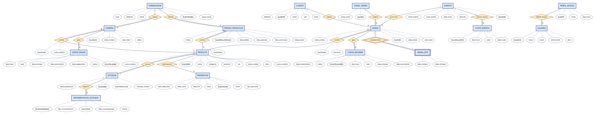

# DER — Sistema de Gestão Comercial

Este repositório documenta o modelo de dados de uma empresa de moda automotiva e streetwear por meio do modelo conceitual, do modelo lógico e de uma descrição resumida do escopo.

## Modelos de dados

### Modelo conceitual — notação Chen



[Ver ou baixar o arquivo SVG do modelo conceitual](model/der_conceitual_chen.svg).

### Modelo lógico



O diagrama lógico também está disponível em [formato PNG](model/DER.svg), e seu código-fonte editável em [Mermaid](model/der.mmd).

## Situação dos arquivos SQL

Os arquivos SQL e os materiais auxiliares de execução e teste foram removidos da branch `main` a pedido da autora, que irá reescrevê-los e adicioná-los novamente. No momento, este repositório não contém scripts SQL executáveis.

## Organização do repositório

```text
.
├── README.md
└── model/
    ├── der_conceitual_chen.svg  # Modelo conceitual, notação Chen
    ├── der.mmd                  # Fonte Mermaid do modelo lógico
    └── der.png                  # Renderização do modelo lógico
```

## Escopo do modelo

O modelo lógico contém 21 entidades:

| Entidade | Finalidade representada |
| --- | --- |
| `FORNECEDOR` | Dados de fornecedores. |
| `COMPRA` | Compras realizadas. |
| `ITEM_COMPRA` | Produtos, quantidades e custos de cada compra. |
| `PRODUTO` | Produtos comercializados ou produzidos. |
| `ESTOQUE` | Saldo atual e estoque mínimo por produto. |
| `MOVIMENTACAO_ESTOQUE` | Entradas, saídas e ajustes de estoque. |
| `PEDIDO_PRODUCAO` | Ordens de produção e seus dados operacionais. |
| `ITEM_PEDIDO_PRODUCAO` | Produtos e quantidades por ordem de produção. |
| `CLIENTE` | Dados dos clientes. |
| `CANAL_VENDA` | Canais utilizados nas vendas. |
| `VENDA` | Registros de vendas. |
| `VENDA_SITE` | Dados de entrega de vendas realizadas pelo site. |
| `ITEM_VENDA` | Produtos, quantidades e descontos por venda. |
| `EVENTO` | Eventos comerciais. |
| `CUSTO_EVENTO` | Custos associados a eventos. |
| `PROMOCAO` | Períodos, tipos e valores de promoções. |
| `ITEM_PROMOCAO` | Produtos abrangidos por promoções. |
| `CONTA_PAGAR` | Obrigações financeiras e parcelas associadas a compras. |
| `CONTA_RECEBER` | Valores a receber e parcelas associadas a vendas. |
| `PERFIL_ACESSO` | Perfis de acesso. |
| `USUARIO` | Usuários e seus perfis de acesso. |

O modelo lógico representa compras e vendas por tabelas de itens, associa produtos a promoções, relaciona custos a eventos e permite parcelas a pagar e a receber. `VENDA_SITE` é modelada como extensão opcional de `VENDA`; essa cardinalidade ainda deve ser confirmada com as regras reais da empresa.

As participações mínimas — por exemplo, uma compra ter ao menos um item — são representadas no diagrama, mas precisam ser validadas de acordo com as regras reais da empresa.
