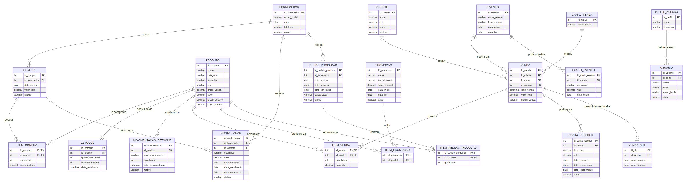

<div align="center">

# DER — Sistema de Gestão Comercial


<strong>Modelo lógico de dados para apoiar a gestão comercial de uma empresa de moda automotiva e streetwear.</strong>


[**Visualizar o diagrama**](DER/der.png) · [**Ver código Mermaid**](DER/der.mmd) · [**SQL PostgreSQL**](DER/der.sql) · [**Print da execução**](DER/evidencias/execucao_sql_pgadmin.png)

</div>

---

## Sobre o projeto

O modelo organiza dados dos processos identificados para o ERP: compras e fornecedores, produção, produtos e estoque, vendas presenciais e pelo site, eventos, promoções, equipe e controle de acesso, além dos compromissos financeiros.

A revisão procura manter coerência entre o escopo documentado e o DER. Foram formalizadas as entidades citadas na devolutiva que ainda não apareciam de forma integrada no modelo: `PEDIDO_PRODUCAO`, `USUARIO`, `PERFIL_ACESSO`, `CUSTO_EVENTO`, `PROMOCAO` e `CONTA_RECEBER`. Para itens de produção e produtos participantes de promoções, foram incluídas entidades associativas para representar os relacionamentos N:N.

## Diagrama Entidade-Relacionamento



O arquivo-fonte do diagrama é [`DER/der.mmd`](DER/der.mmd). A imagem acima é gerada a partir desse arquivo.

## SQL e evidência de execução

O script [`DER/der.sql`](DER/der.sql) cria as tabelas e os relacionamentos do modelo no PostgreSQL. A captura [`DER/evidencias/execucao_sql_pgadmin.png`](DER/evidencias/execucao_sql_pgadmin.png) registra no pgAdmin a consulta ao catálogo `information_schema.tables` com retorno de 21 tabelas.

## Entidades do modelo

| Entidade | Descrição |
| --- | --- |
| `FORNECEDOR` | Armazena os dados dos fornecedores. |
| `COMPRA` | Registra as compras realizadas. |
| `ITEM_COMPRA` | Relaciona produtos às compras e registra quantidade e custo unitário. |
| `PRODUTO` | Armazena os produtos comercializados ou produzidos. |
| `ESTOQUE` | Controla o saldo atual e o estoque mínimo por produto. |
| `MOVIMENTACAO_ESTOQUE` | Registra entradas, saídas e ajustes de estoque. |
| `PEDIDO_PRODUCAO` | Registra fornecedor, prazos, etapa atual e situação de uma ordem de produção. |
| `ITEM_PEDIDO_PRODUCAO` | Relaciona os produtos e quantidades de cada pedido de produção. |
| `CLIENTE` | Armazena os dados dos clientes. |
| `CANAL_VENDA` | Identifica o canal utilizado em cada venda. |
| `VENDA` | Registra as vendas e seus dados comerciais. |
| `VENDA_SITE` | Armazena dados específicos de entrega de uma venda realizada pelo site. |
| `ITEM_VENDA` | Relaciona produtos às vendas e registra quantidade e desconto. |
| `EVENTO` | Armazena os eventos relacionados à operação comercial. |
| `CUSTO_EVENTO` | Registra custos associados a cada evento. |
| `PROMOCAO` | Armazena período, tipo e valor de uma promoção. |
| `ITEM_PROMOCAO` | Relaciona os produtos abrangidos por cada promoção. |
| `CONTA_PAGAR` | Registra obrigações financeiras, inclusive parcelas associadas a compras. |
| `CONTA_RECEBER` | Registra valores a receber e seus vencimentos, inclusive parcelas associadas a vendas. |
| `PERFIL_ACESSO` | Define os perfis de acesso disponíveis no sistema. |
| `USUARIO` | Armazena os usuários e o perfil de acesso atribuído a cada um. |

## Relacionamentos e regras representados

- Uma compra possui um ou mais itens; cada item identifica um produto, sua quantidade e seu custo unitário.
- Uma venda possui um ou mais itens; cada item identifica um produto, a quantidade e o desconto aplicado.
- Cada produto possui um registro de estoque e pode ter várias movimentações.
- Uma compra pode gerar nenhuma ou várias contas a pagar. Cada conta a pagar pertence a um fornecedor e pode estar vinculada a uma compra; a conta representa a obrigação, não a compra em si.
- Uma venda pode gerar nenhuma ou várias contas a receber, permitindo representar parcelamento. Cada conta a receber pertence a uma venda; a venda não é, por si só, uma conta a receber.
- Um pedido de produção pertence a um fornecedor e contém um ou mais itens de produção. Cada item aponta para um produto e sua quantidade.
- Um evento pode ter vários custos e pode estar relacionado a várias vendas.
- Uma promoção pode abranger vários produtos, e um produto pode participar de várias promoções; `ITEM_PROMOCAO` registra essa associação.
- Cada usuário possui um perfil de acesso; um perfil pode ser atribuído a vários usuários.

## Ponto pendente de validação com a empresa

O DER representa `VENDA_SITE` como extensão opcional de `VENDA`: cada venda pode ter zero ou um registro de dados do site, e cada registro de `VENDA_SITE` pertence a uma única venda. Por isso, `id_venda` é uma chave estrangeira única nessa entidade. Essa cardinalidade é uma proposta de modelagem, não uma decisão validada com a empresa. É necessário confirmar se o processo real do site corresponde a essa relação antes de considerar o modelo financeiro e de vendas consolidado.

## Arquivos

```text
.
├── DER/
│   ├── der.mmd    # Código-fonte Mermaid do DER
│   ├── der.png    # Imagem renderizada do DER
│   ├── der.sql    # DDL PostgreSQL correspondente ao DER
│   └── evidencias/
│       └── execucao_sql_pgadmin.png  # Captura do pgAdmin mostrando 21 tabelas
└── README.md      # Documentação do modelo
```

## Tecnologias e conceitos

`Modelo lógico` · `DER` · `Normalização` · `Chaves primárias e estrangeiras` · `Mermaid` · `Git` · `GitHub`

## Status

**Em desenvolvimento**

## Autor

Desenvolvido por [Larycronx](https://github.com/Larycronx).

---

<sub>README do projeto DER — Sistema de Gestão Comercial.</sub>
</div>
